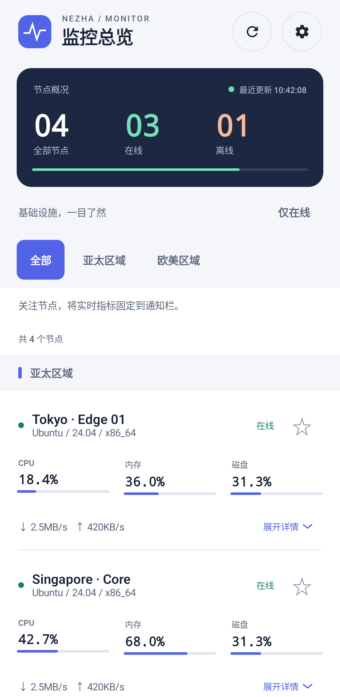
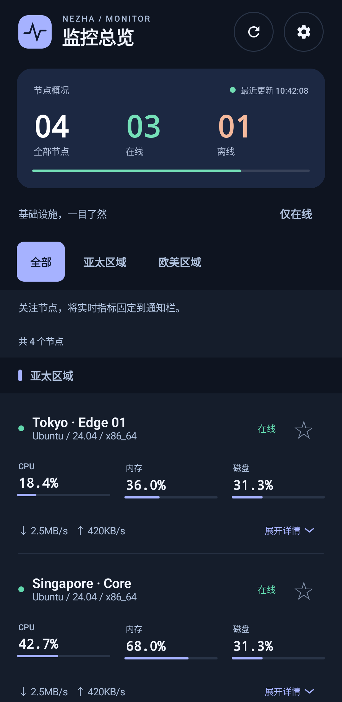
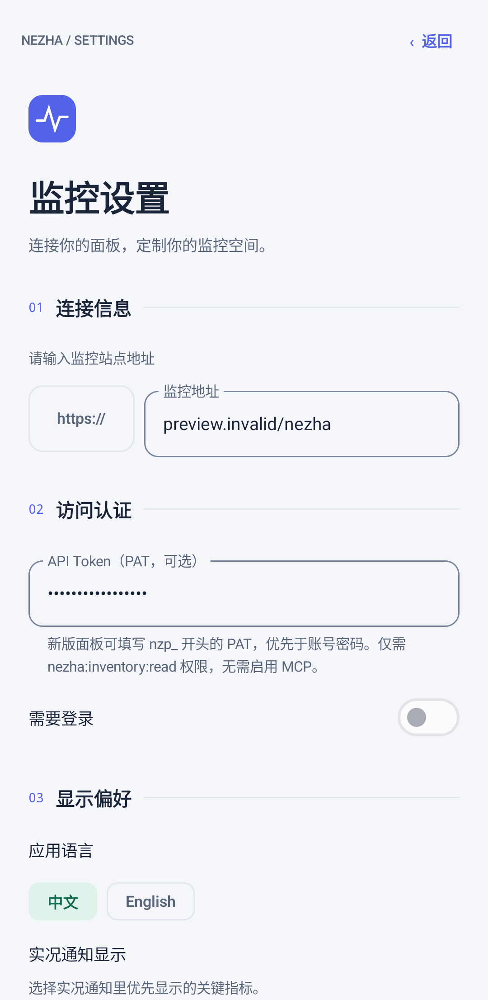
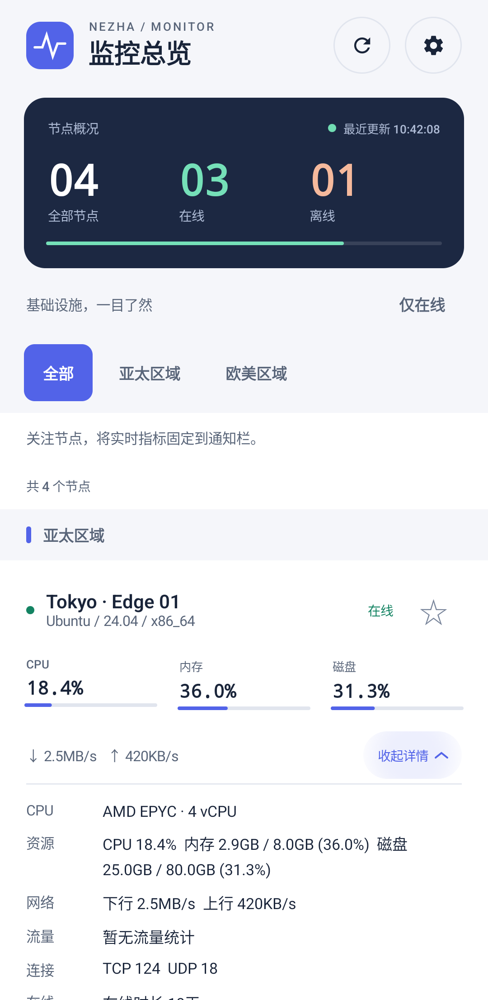
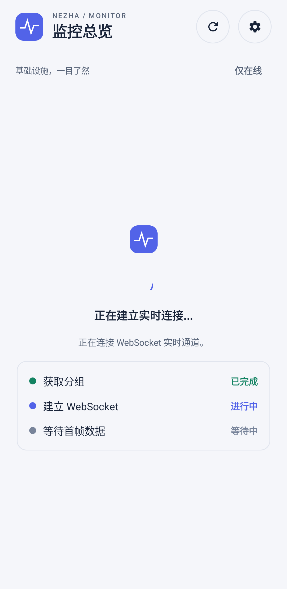

# 哪吒状态监控 / Nezha Monitor Android

一个基于 [Nezha Monitoring](https://github.com/nezhahq/nezha) 面板接口开发的 Android 手机端客户端，用来在手机上查看服务器在线状态、资源占用、网络流量与分组信息，并通过系统常驻通知持续跟踪关注节点。

这个项目是面向手机端的第三方客户端，不是哪吒面板本体，也不隶属于哪吒监控官方项目组。

## 2.0.0 更新

- **全新界面**：定制深浅色总览、扁平节点列表、资源占用条和可展开详情，不再堆叠默认卡片。
- **新版哪吒兼容**：增加 Personal Access Token（PAT）认证，保留游客访问和账号密码登录。
- **设置与安全**：重新组织连接、认证和显示设置；清理凭据日志并排除含凭据配置的系统备份。

当前源码版本为 `2.0.0`（`versionCode = 2`），详细变更见 [CHANGELOG.md](./CHANGELOG.md)。尚未创建 `v2.0.0` 标签或对应 Release。

## 功能特性

- 定制深浅色监控界面：节点总览、扁平列表、CPU/内存/磁盘占用条，以及可展开的节点详情
- 基于哪吒面板接口获取节点状态，并通过 WebSocket 订阅实时数据
- 支持节点分组展示、全部节点视图、仅在线筛选
- 支持关注单个节点，并在系统通知中持续显示该节点的最新状态
- 支持需要登录的面板，自动调用 `/api/v1/login` 获取 `nz-jwt`
- 支持新版面板 Personal Access Token（PAT），通过 Bearer 认证读取分组和实时状态
- 自动适配 `http/https` 到 `ws/wss`
- 支持中英文界面切换
- 支持展示 CPU、内存、磁盘、流量、连接数、IP、套餐和账单等信息

## 当前接入的接口

应用当前围绕哪吒面板以下接口工作：

- `/api/v1/login`
- `/api/v1/server-group`
- `/api/v1/ws/server`

如果你的部署、反代或鉴权方式修改了这些接口行为，需要按实际情况调整代码。

## 运行要求

- Android Studio
- Android SDK 36
- JDK 17 或更高版本
- Android 12 及以上设备

当前项目配置：

- `compileSdk = 36`
- `targetSdk = 36`
- `minSdk = 31`

## 本地构建

### 使用 Android Studio

1. 克隆仓库
2. 用 Android Studio 打开项目根目录
3. 等待 Gradle 同步完成
4. 运行 `app` 模块到真机或模拟器

### 使用命令行

Windows:

```powershell
.\gradlew.bat assembleDebug
```

macOS / Linux:

```bash
./gradlew assembleDebug
```

调试包输出位置：

```text
app/build/outputs/apk/debug/
```

## 使用说明

首次启动后，在设置页填写你的监控地址。

- 可以直接填写面板站点地址，例如 `https://your-nezha.example.com`
- 如果面板需要登录，打开“需要登录”并填写用户名和密码
- 新版面板也可填写“API Token（PAT，可选）”，填写后优先使用 PAT，不再请求账号密码登录
- 应用会自动拼接并请求对应的 API 与 WebSocket 地址
- 关注某个节点后，应用会启动前台服务，在系统通知里持续更新该节点状态

### 新版哪吒 V2 / PAT 接入

哪吒 V2 的 REST API 仍使用 `/api/v1` 路径，不能改成 `/api/v2`。本客户端采用 API + WebSocket 接入，未实现 MCP 客户端，不需要开启面板的 `enable_mcp`。

1. 在面板管理前端的“系统设置 → API Tokens”创建 PAT。
2. 按当前上游路由，应用读取 `/api/v1/server-group` 和 `/api/v1/ws/server` 只需要 `nezha:inventory:read`；不需要命令执行、文件操作或管理权限。可按需限制服务器 ID 和有效期。
3. 应用设置中填写面板地址，以及完整的 `nzp_...` Token；不要手动添加 `Bearer ` 前缀。
4. 保存后，分组请求和实时 WebSocket 均携带 `Authorization: Bearer <PAT>`；常驻通知使用同一配置。

PAT 留空时，原有游客访问和账号密码登录方式保持可用。账号密码登录后的 JWT 同时通过 Bearer 和 `nz-jwt` Cookie 发送，以兼容新旧面板。支持带路径前缀的反向代理地址。

Token 使用与现有登录配置相同的应用私有偏好存储（未额外加密），不会写入请求日志；含凭据的配置文件不参与系统云备份或设备迁移。卸载、清除数据或换机后需要重新配置。

参考：[官方 API 文档](https://nezha.wiki/guide/api.html)、[官方 MCP 文档](https://nezha.wiki/guide/mcp.html)、[上游接口路由](https://github.com/nezhahq/nezha/blob/master/cmd/dashboard/controller/controller.go)。权限及返回结构以实际部署版本为准。本次兼容需在目标面板和设备上进一步联调。

## 界面预览

以下为新界面的模拟器截图，使用测试数据，不代表实际服务器状态。新界面保留分组滑动、仅在线筛选、节点关注和常驻通知；资源指标缺失时显示 `—`，不会伪造为零，离线节点不会把旧指标当作实时读数展示。

设置页按连接、认证、显示偏好分区；配色随系统切换深浅色，使用固定品牌色而非壁纸动态配色。

<p align="center">
  
  
  
</p>

<p align="center">
  
  
</p>

<details>
<summary>旧版界面存档</summary>
以下仅为旧版存档，新版界面请参阅上方预览。

<p align="center">
  
  
</p>

<p align="center">
  
  
</p>

<p align="center">
  
</p>

<p align="center">
  
  
</p>

</details>

## 测试与验证

单元测试覆盖 PAT / JWT / 游客认证、地址与反代路径、API 错误格式以及资源指标计算。运行：

```powershell
.\gradlew.bat :app:testDebugUnitTest :app:assembleDebug
```

界面测试使用固定演示数据，不访问实际面板。仅连接用于测试的 Android 模拟器或设备后运行：

```powershell
.\gradlew.bat :app:connectedDebugAndroidTest -Pandroid.testInstrumentationRunnerArguments.class=com.atigger.status.DashboardUiTest
```

macOS / Linux 将 `.\gradlew.bat` 替换为 `./gradlew`。

本地已通过 24 项单元测试、8 项模拟器界面测试及 Debug APK 构建。界面测试覆盖深浅色、分组切换、在线筛选、详情展开、关注操作、设置保存、大字体以及加载 / 空 / 错误状态；尚未完成实际新版面板和真机联调。

已知问题：`lintDebug` 仍报告 `ServerLiveUpdateService.kt` 中两处既有的通知权限检查错误（`MissingPermission`，当前为第 119、132 行），尚未在本次更新中修复。

## 项目结构

```text
app/src/main/java/com/atigger/status/
├── MainActivity.kt
├── ServerLiveUpdateService.kt
├── LiveUpdateActionReceiver.kt
├── data/
├── i18n/
└── ui/
```

## 与上游项目的关系

本项目的功能实现建立在哪吒面板现有接口与数据结构之上，灵感和兼容目标来源于上游项目：

- 上游项目: [nezhahq/nezha](https://github.com/nezhahq/nezha)

如果你在使用过程中发现接口兼容问题，优先检查你所使用的哪吒版本、反向代理配置，以及是否对默认 API 做过二次修改。

## 开源协议

本项目沿用上游 [nezhahq/nezha](https://github.com/nezhahq/nezha) 的开源协议，采用 Apache License 2.0，详见 [LICENSE](./LICENSE)。

## 免责声明

- 本项目为个人维护的第三方 Android 客户端
- 本项目不保证兼容所有魔改版、二开版或历史版本哪吒面板
- 因配置错误、反代设置、接口变更导致的连接失败，需要按实际部署环境自行排查
